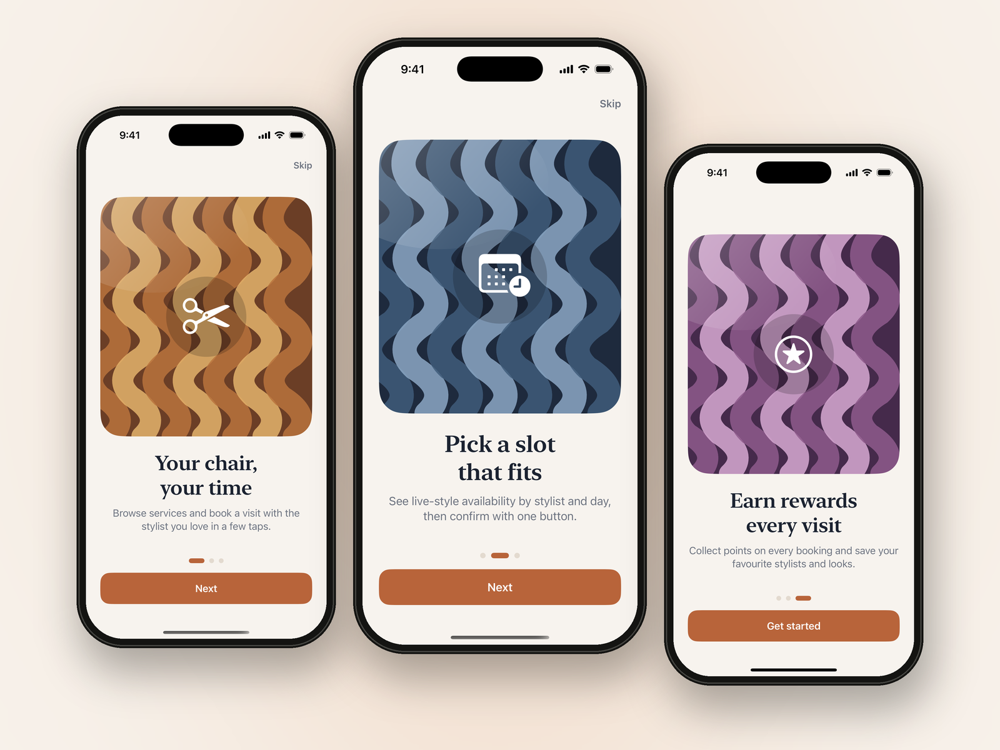
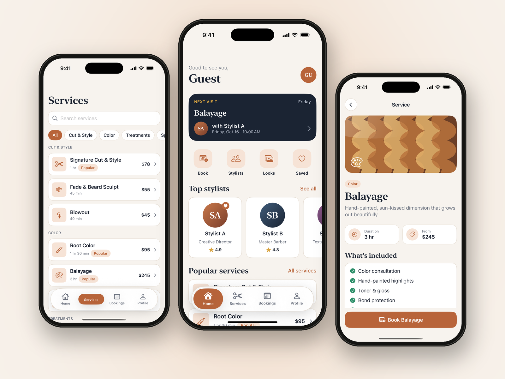
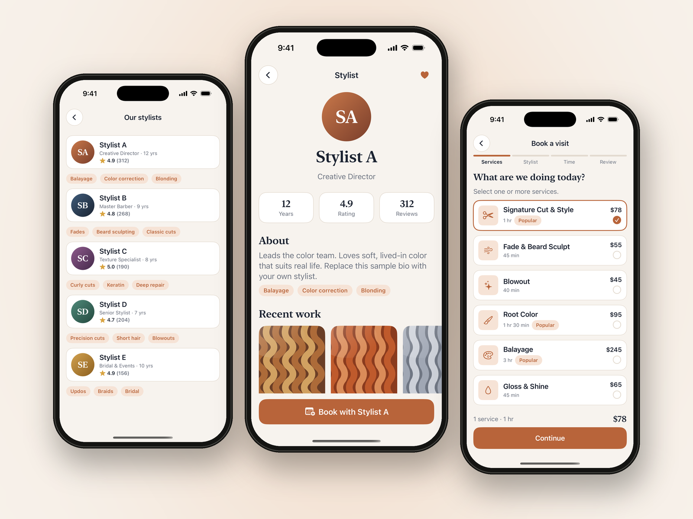
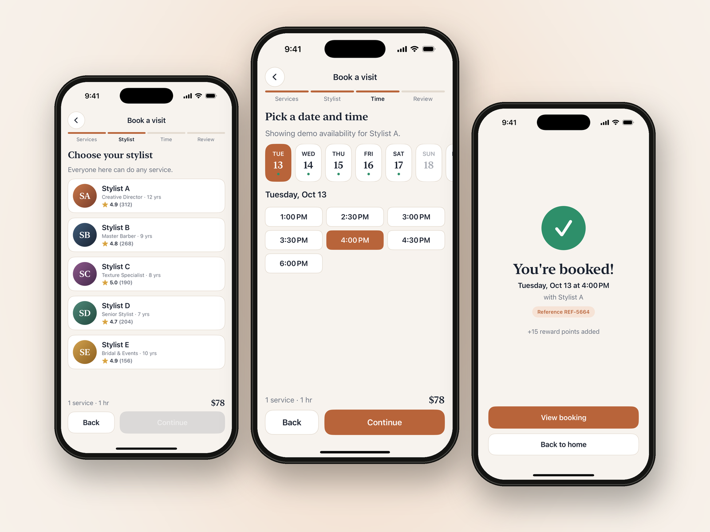
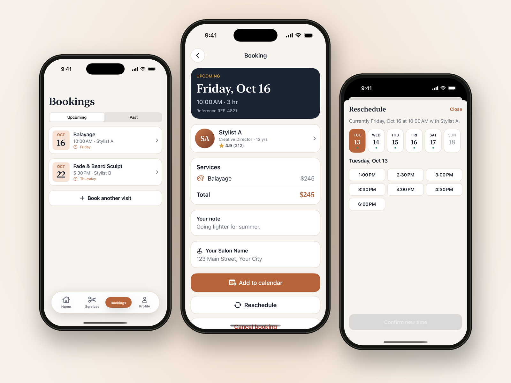
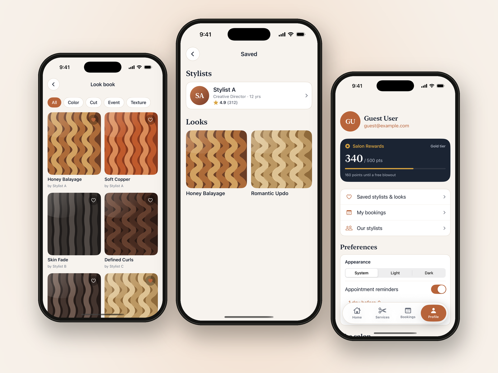
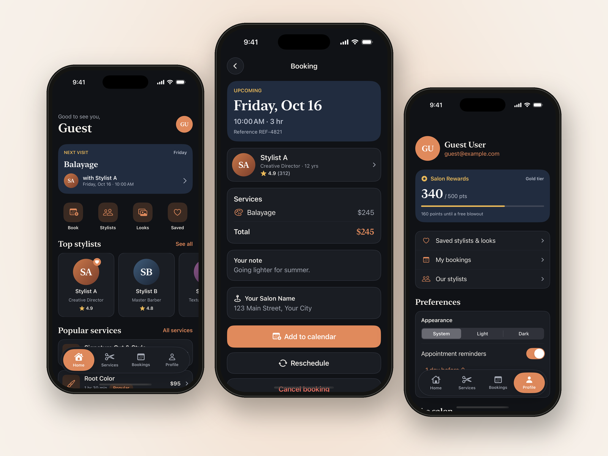

# Hair Salon Booking App (SwiftUI UI Template)

A complete **SwiftUI** UI template for a hair salon booking app, with onboarding, services, stylist profiles, a 4-step booking flow, booking management, a look book and rewards. Light and dark mode. **Get the full source code here: [https://qinqin4.gumroad.com/l/rznllw]**

## What's included
- 3-page onboarding
- Home with next visit, top stylists, popular services, fresh looks and offers
- Service list with search and category filter, plus service detail
- Stylist list and profiles with stats, bio, recent work and reviews
- Booking flow: services, stylist, date and time, review with note, confirmation
- Upcoming and past bookings, booking detail, reschedule sheet, cancel confirmation
- Look book, saved stylists and looks, profile with rewards and preferences
- Design system (light/dark palette, Dynamic Type), generated app icon, 8 unit tests
- Xcode project for iOS 17+ and Swift 6, no third-party dependencies
- README, Quick Start, Customization, Screen Overview and License Notes

## Please note
This is a **UI template only**. It has **no real backend, login, database or payments**. Bookings, availability, rewards and reminders are demo content kept in memory and reset when the app relaunches. Plug in your own services.

[Get the template: https://qinqin4.gumroad.com/l/rznllw]
